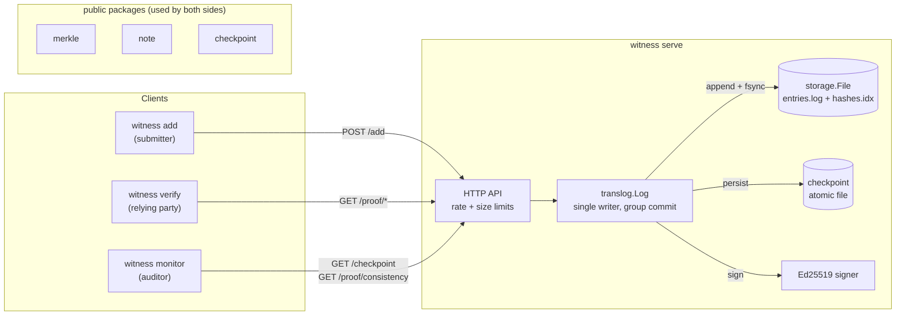

# witness

**A tamper-evident, append-only transparency log in Go, with RFC 6962 Merkle proofs, C2SP signed checkpoints, and a monitor that catches the log lying.**

[](https://github.com/marcus-girolneto/witness/actions/workflows/ci.yml)
[](https://pkg.go.dev/github.com/marcus-girolneto/witness)
[](https://goreportcard.com/report/github.com/marcus-girolneto/witness)
[](LICENSE)

`witness` is a transparency log in the style of Certificate Transparency,
Trillian and Go's checksum database. You append entries such as release
hashes, certificates or audit events. Every entry gets a signed receipt
that anyone can verify offline. A monitor can then prove that the log has
never rewritten, reordered or deleted anything, and that it has shown the
same history to everyone.

## Why it exists

An append-only database is easy to build if you trust whoever runs it. A
transparency log removes that trust. The operator signs a small *checkpoint*
(tree size plus Merkle root) and must back every later checkpoint with a
logarithmic-size proof that the old tree is a prefix of the new one. The
operator can still lie, but every lie leaves behind two signed checkpoints
that contradict each other, and anyone can check that evidence with only the
public key.

This project implements that idea end to end. The cryptography is meant to be
exact, so it is checked against the RFC definitions, published test vectors
and an independent implementation, then fuzzed. Each layer also has to
handle the failures that real deployments run into: torn writes, bit rot, a
wiped disk, and an operator who holds the key and wants to rewrite history.

## Features

- **`merkle`**: an importable package for RFC 6962 / RFC 9162 tree hashing with 0x00/0x01 domain separation over SHA-256. It covers the Merkle Tree Hash for any size, inclusion and consistency proof generation, and **standalone verification** that needs no tree. Proofs read O(log n) stored subtree hashes in one batched call.
- **`note` and `checkpoint`**: Ed25519 [C2SP signed notes](https://c2sp.org/signed-note) and [tlog checkpoints](https://c2sp.org/tlog-checkpoint). Tests verify wire compatibility with `golang.org/x/mod/sumdb/note` in both directions.
- **Crash-safe storage**: length-prefixed, CRC-32C records plus a flat hash index. On open the store truncates a torn tail, rebuilds a lagging index and refuses corruption that a crash cannot explain. The server will not start below its last signed checkpoint.
- **Group-commit sequencer**: concurrent adds share one fsync and one signature, giving **about 18k durable adds/s** where per-entry fsync allows about 100/s.
- **HTTP API** with per-IP rate limits, entry size limits, server timeouts, and immutable caching of proofs for fixed tree sizes.
- **CLI** with `serve`, `keygen`, `add`, `verify` and `monitor`. `verify` checks receipts offline. `monitor` detects **split views, forks and rollbacks** and prints the signed evidence.
- A [threat model](docs/threat-model.md) that states what the log guarantees, what needs gossip or witnesses, and what is out of scope.

## Quick start

```sh
git clone https://github.com/marcus-girolneto/witness && cd witness
make build                                              # bin/witness
./bin/witness keygen -name example.com/log -out log     # log.key (secret), log.vkey (public)
./bin/witness serve -key log.key -data ./data &         # http://localhost:8080
echo "hello, transparency" | ./bin/witness add -vkey log.vkey
```

With Docker (distroless, non-root, about 16 MB):

```sh
make docker-build
docker run --rm -p 8080:8080 -v witness-data:/data \
  -v "$PWD/log.key:/keys/log.key:ro" witness:dev
```

To replay the full session below on your machine, run
`make build && scripts/demo.sh`.

## A real session

The output below comes from a run of [`scripts/demo.sh`](scripts/demo.sh) on
an Apple Silicon laptop. Nothing is edited except one repeated evidence
block, which is marked where it is shortened. The full transcript is in
[`docs/demo-output.txt`](docs/demo-output.txt).

### 1. An honest log

```console
$ witness keygen -name example.com/log -out log
wrote log.key (private, keep secret) and log.vkey
example.com/log+617b6dc6+AZVud+jsWqrdpKZ2aBTDw7pac16euW6/o4sj/dEXPQyW

$ witness serve -key log.key -data ./data &

$ echo "release v1.4.2 sha256:4d7a2c1e" | witness add -vkey log.vkey -o receipt.json
verified: entry 0 is included in signed tree of size 1
entry 0: receipt written to receipt.json

$ for v in 1.4.3 1.5.0 1.5.1 2.0.0; do echo "release v$v" | witness add > /dev/null; done

$ cat receipt.json
{
  "index": 0,
  "leaf_hash": "df/PKZCO47hgh/J+Votuo2YT34DV7AFWdNbifF9WDCI=",
  "checkpoint": "example.com/log\n1\ndf/PKZCO47hgh/J+Votuo2YT34DV7AFWdNbifF9WDCI=\n\n— example.com/log YXttxhbPOwu8+b3mVo1uA92k6mRRwb7pNzQS7HgXY76CtQdOPdn29gutVOpck638R3JJB+HOoDx4Ik//vZTLagJPkg4=\n",
  "inclusion_proof": []
}

$ curl -s localhost:8080/checkpoint
example.com/log
5
0KxgKKKO2q5fYiVRs/nG5bcV1m7Qn6WTOEJv6o9bAUk=

— example.com/log YXttxm8gTWErFCy/5KFXWAPXOrB77RBSbe7LYwuhMTWxIpmioP2fpUV2ahDal1M9Mrhx64I4BFz2SJiRwbVRXqtWDwc=

$ curl -s "localhost:8080/proof/consistency?old=1&new=5"
{"old":1,"new":5,"proof":["eUXsCqsIak9aY3nAtHaB4y4VRNb2UDhzmpWkpMhlXko=","jFniZcs4acBLKSroruaCKn8V3kGqYoFa3TMAxUJFe4U=","UfrijEgIvADiAqDx8jAEo8uOsT+3fdVhJjiyCAeWzkQ="]}

$ echo "release v1.4.2 sha256:4d7a2c1e" > entry.txt

$ witness verify -vkey log.vkey -receipt receipt.json -entry entry.txt -log http://localhost:8080
OK  entry is included at index 0 in example.com/log tree of size 1 (root df/PKZCO47hgh/J+Votuo2YT34DV7AFWdNbifF9WDCI=)
OK  receipt tree of size 1 is consistent with current tree of size 5 (root 0KxgKKKO2q5fYiVRs/nG5bcV1m7Qn6WTOEJv6o9bAUk=)

$ witness verify -vkey log.vkey -log http://localhost:8080 -index 3
OK  entry 3 ("release v1.5.1") is included in example.com/log tree of size 5 (root 0KxgKKKO2q5fYiVRs/nG5bcV1m7Qn6WTOEJv6o9bAUk=)

$ witness monitor -vkey log.vkey -log http://localhost:8080 -state monitor.state -once
time=2026-10-17T09:21:19.711-03:00 level=INFO msg="trusting first checkpoint (trust on first use)" source=http://localhost:8080 size=5 root="0KxgKKKO2q5fYiVRs/nG5bcV1m7Qn6WTOEJv6o9bAUk="
OK  example.com/log size 5 root 0KxgKKKO2q5fYiVRs/nG5bcV1m7Qn6WTOEJv6o9bAUk=
```

The receipt is self-contained. Its checkpoint is signed and the inclusion proof is
empty because the tree had one leaf at the time. `verify -log` also asks the
log for a consistency proof from the receipt's tree to the current tree. That
check proves the entry is still in the log people see today.

### 2. The operator tampers with storage

```console
$ kill %1

$ printf "X" | dd of=data/log/entries.log bs=1 seek=60 conv=notrunc 2>/dev/null

$ witness serve -key log.key -data ./data
witness serve: storage: corrupt data: record 1 at offset 47: checksum mismatch
# exit status 1

$ rm -rf data/log

$ witness serve -key log.key -data ./data
witness serve: translog: store does not match last signed checkpoint: store has 0 entries, checkpoint commits to 5
# exit status 1
```

Accidental and crude tampering is caught locally. CRCs catch flipped bits, and
the last persisted checkpoint stops a history that shrank. An operator who
holds the key can get around both, which is why monitors exist.

### 3. The operator rebuilds the log with the same key

```console
$ rm -rf data

$ witness serve -key log.key -data ./data &

$ for v in 1.4.2 1.4.3-backdoored 1.5.0; do echo "release v$v" | witness add > /dev/null; done

$ witness monitor -vkey log.vkey -log http://localhost:8080 -state monitor.state -once
time=2026-10-17T09:21:20.877-03:00 level=ERROR msg="LOG MISBEHAVIOUR DETECTED" kind=rollback source=http://localhost:8080 detail="tree size went back from 5 to 3 and no source can prove the smaller tree is a prefix"
!!!!!!!!!!!!!!!!!!!!!!!!!!!!!!!!!!!!!!!!!!!!!!!!!!!!!!!!!!!!!!!!!!!!!!
!!! ALERT: rollback detected at http://localhost:8080
!!! tree size went back from 5 to 3 and no source can prove the smaller tree is a prefix
!!!!!!!!!!!!!!!!!!!!!!!!!!!!!!!!!!!!!!!!!!!!!!!!!!!!!!!!!!!!!!!!!!!!!!
Evidence: both checkpoints below carry valid signatures from the log key
and cannot both be honest. Publish them.
--- previously trusted ---
example.com/log
5
0KxgKKKO2q5fYiVRs/nG5bcV1m7Qn6WTOEJv6o9bAUk=

— example.com/log YXttxm8gTWErFCy/5KFXWAPXOrB77RBSbe7LYwuhMTWxIpmioP2fpUV2ahDal1M9Mrhx64I4BFz2SJiRwbVRXqtWDwc=
--- observed ---
example.com/log
3
4Kc/3uY8kVPewlaCuzHrMRtvMb1YQ7UXp1ZNpF8mua8=

— example.com/log YXttxoLacsGFOXaY5DL+rW5DNuinNAIkh7EhDQeQDPDtntUC8liy+o2+p76H99BpT5cL030oDSB4ZqBDnE7hY2PbeQs=
witness monitor: verification failed: 1 alert(s)
# exit status 3

$ for v in 1.5.1 2.0.0 2.0.1 2.1.0; do echo "release v$v" | witness add > /dev/null; done

$ witness monitor -vkey log.vkey -log http://localhost:8080 -state monitor.state -once
time=2026-10-17T09:21:20.998-03:00 level=ERROR msg="LOG MISBEHAVIOUR DETECTED" kind=fork source=http://localhost:8080 detail="size 7 is not an extension of trusted size 5: merkle: invalid proof: computed old root QGfQrxNteFAbfSXdQvpcQy2zO2KXXWEGINvJZPiHa2Y= does not match 0KxgKKKO2q5fYiVRs/nG5bcV1m7Qn6WTOEJv6o9bAUk="
!!!!!!!!!!!!!!!!!!!!!!!!!!!!!!!!!!!!!!!!!!!!!!!!!!!!!!!!!!!!!!!!!!!!!!
!!! ALERT: fork detected at http://localhost:8080
!!! size 7 is not an extension of trusted size 5: merkle: invalid proof: computed old root QGfQrxNteFAbfSXdQvpcQy2zO2KXXWEGINvJZPiHa2Y= does not match 0KxgKKKO2q5fYiVRs/nG5bcV1m7Qn6WTOEJv6o9bAUk=
!!!!!!!!!!!!!!!!!!!!!!!!!!!!!!!!!!!!!!!!!!!!!!!!!!!!!!!!!!!!!!!!!!!!!!
[signed evidence omitted here, see docs/demo-output.txt]
witness monitor: verification failed: 1 alert(s)
# exit status 3

$ witness verify -vkey log.vkey -receipt receipt.json -entry entry.txt -log http://localhost:8080
OK  entry is included at index 0 in example.com/log tree of size 1 (root df/PKZCO47hgh/J+Votuo2YT34DV7AFWdNbifF9WDCI=)
witness verify: verification failed: receipt tree is not a prefix of the current log: merkle: invalid proof: computed new root uzlARYQRrz5SaZacs7vmgeyvtg73pLsXP1bAnsftIGc= does not match yiwLVxeTt5eElYbqCbtVk5j5FubpWoRtqhXg98J2sWU=
# exit status 3
```

The monitor had persisted the size-5 checkpoint. The rebuilt log first shows
up as a rollback. Once it grows past size 5 it shows up as a fork, because
the log cannot produce a consistency proof from the old root. The old receipt
also fails against the new log. In both cases the alert includes two
checkpoints signed by the same key that contradict each other, which proves
misbehaviour.

### 4. The operator shows different histories to different audiences

```console
$ witness serve -key log.key -data ./mirror -addr :8081 &

$ for i in 1 2 3 4 5 6 7; do echo "entry $i" | witness add -log http://localhost:8081 > /dev/null; done

$ witness monitor -vkey log.vkey -log http://localhost:8080 -log http://localhost:8081 -once
time=2026-10-17T09:21:22.222-03:00 level=INFO msg="trusting first checkpoint (trust on first use)" source=http://localhost:8080 size=7 root="yiwLVxeTt5eElYbqCbtVk5j5FubpWoRtqhXg98J2sWU="
time=2026-10-17T09:21:22.223-03:00 level=ERROR msg="LOG MISBEHAVIOUR DETECTED" kind=split-view source=http://localhost:8081 detail="size 7 has root XgvamW7wmyxN2Xzc3RyRbJmOy29NMA/N/HL4iF2Hvg0=, trusted root is yiwLVxeTt5eElYbqCbtVk5j5FubpWoRtqhXg98J2sWU="
!!!!!!!!!!!!!!!!!!!!!!!!!!!!!!!!!!!!!!!!!!!!!!!!!!!!!!!!!!!!!!!!!!!!!!
!!! ALERT: split-view detected at http://localhost:8081
!!! size 7 has root XgvamW7wmyxN2Xzc3RyRbJmOy29NMA/N/HL4iF2Hvg0=, trusted root is yiwLVxeTt5eElYbqCbtVk5j5FubpWoRtqhXg98J2sWU=
!!!!!!!!!!!!!!!!!!!!!!!!!!!!!!!!!!!!!!!!!!!!!!!!!!!!!!!!!!!!!!!!!!!!!!
Evidence: both checkpoints below carry valid signatures from the log key
and cannot both be honest. Publish them.
--- previously trusted ---
example.com/log
7
yiwLVxeTt5eElYbqCbtVk5j5FubpWoRtqhXg98J2sWU=

— example.com/log YXttxquz7IMycbrilHpRCgb9vS0qGwa2685rDyIzG5WklAbi5PzZ58zJTfrt5kNLg3BCdoG2hy8FcXt58N+Uba6FKAs=
--- observed ---
example.com/log
7
XgvamW7wmyxN2Xzc3RyRbJmOy29NMA/N/HL4iF2Hvg0=

— example.com/log YXttxt7/9TPfp6lvRArlq5sqBSIPONA5N5qa8VPmpwCznXHWKt7qhT18xr7FLGi3BxwoiZGX22mI3yjMcWMuysGNCgM=
witness monitor: verification failed: 1 alert(s)
# exit status 3
```

## HTTP API

| Method & path | Description |
| --- | --- |
| `POST /add` | Body is the raw entry (max 64 KiB by default). Returns `{index, leaf_hash, checkpoint, inclusion_proof}` once the entry is durable and covered by a signed checkpoint. |
| `GET /checkpoint` | Latest signed checkpoint, `text/plain`, C2SP format. |
| `GET /proof/inclusion?index=&size=` | Audit path for `index` in the tree of `size` (default: latest). |
| `GET /proof/consistency?old=&new=` | Consistency proof between two sizes (`new` defaults to latest). |
| `GET /entries?start=&end=` | Entries in `[start, end)`, base64, at most 1000 per call. |
| `GET /healthz` | Liveness. |

Sizes above the latest checkpoint are rejected, so the server never reveals
unsigned state. Responses for explicit sizes are `Cache-Control: immutable`.
Errors are JSON `{"error": "..."}` with 400/413/429/503 as appropriate.

## Architecture



An add moves through the system like this:

1. The handler enforces size and rate limits and hands the entry to the sequencer.
2. The sequencer drains every queued request (up to `-max-batch`) and appends them in one write.
3. It fsyncs the entry file and the hash index once.
4. It computes the new root from the in-memory frontier, signs one checkpoint, and atomically replaces the checkpoint file.
5. Only after that does it answer each waiting request with its index and the shared checkpoint.

Clients never trust the server. They verify signatures with `checkpoint.Open`
and proofs with `merkle.Verify*`.

## Design decisions and trade-offs

**RFC 6962 domain separation.** Leaves hash as `SHA-256(0x00 || data)` and
interior nodes as `SHA-256(0x01 || left || right)`. Without the prefixes, the
concatenation of two child hashes is a valid leaf whose hash equals their
parent's. An attacker could then present an interior node as a leaf, prove
"inclusion" of data that was never logged, or build two different trees with
the same root (a second-preimage attack on the tree structure). The tests
build exactly that forgery and check that it is rejected
(`TestDomainSeparation`, and the "interior node as leaf" case in
`TestVerifyInclusionRejectsTampering`).

**Exact RFC semantics, verified three ways.**
1. Every proof matches a literal, recursive transcription of the RFC's `MTH`,
   `PATH` and `SUBPROOF` definitions for every index and every pair of sizes
   up to 130.
2. Roots match the published Certificate Transparency test vectors.
3. Stored hashes, roots and both proof types are byte-identical to
   `golang.org/x/mod/sumdb/tlog`, an independent implementation, at 2,000
   random points in a 20,000-leaf tree.

The verifiers are also fuzzed. The fuzz property is not "doesn't panic"; it
is "accepts nothing except the genuine proof".

**Storing perfect subtrees instead of recomputing.** Each complete subtree
hash is written once, in the order a binary counter completes them, to a flat
file. A tree of n leaves stores `2n - popcount(n)` hashes, and the offset of
any node is a closed-form function of `(level, index)`. This is the same
layout as Go's sumdb. Any RFC subtree decomposes into at most ~log n of these
perfect subtrees, so:

| Operation | Cost |
| --- | --- |
| append | O(1) amortised: 2 hashes per entry on average, from an O(log n) in-memory frontier |
| root of any size | ≤ 64 stored-hash reads |
| inclusion / consistency proof | O(log n) stored-hash reads, one batch |
| verification | O(log n) SHA-256, no allocations |
| open / recovery | O(n): every record is CRC-checked and every hash recomputed |

The alternatives were rejected. Recomputing from the leaves makes a proof
O(n). Trillian's tiled storage is better for huge, distributed logs but much
more complex. Keeping only the frontier makes historical proofs impossible.

**File format.** The entry file holds records of `len | CRC-32C(len ‖ data) | data`
behind an 8-byte magic header. The CRC covers the length, so a corrupted
length cannot point the parser at an attacker-chosen boundary. The hash index
is derived data written *after* entries, so after a crash it can only lag
behind, never run ahead, and recovery rebuilds it. Recovery treats damage at
the end of the file as an interrupted append and truncates it. Damage followed
by valid data cannot come from a crash and is fatal. A bit flip in a length
prefix can make mid-file damage look like a torn tail, so there is a second
line of defence: at startup the log recomputes the root at its last signed
checkpoint and refuses to run if the store is shorter or different. A store
that fails an fsync refuses further writes, because retrying after a failed
fsync can falsely report success. An advisory `flock` stops two processes
from appending to the same log.

**Group commit instead of per-entry fsync.** `F_FULLFSYNC` on macOS costs
about 5 ms. One fsync and one checkpoint per add would cap the log at about
100 adds/s. A single sequencer goroutine takes everything that queued while
the previous batch was syncing, so batch size grows with load. That gives
about 18k durable adds/s with 192 concurrent clients, while each client still
gets its receipt only after its entry is durable and signed. A single writer
also makes ordering trivial and removes any chance of two checkpoints racing.

**Checkpoint per batch, no timestamps.** Checkpoints follow C2SP
`tlog-checkpoint`: origin, size, base64 root, and optional extension lines,
inside a signed note. Parsing is strictly canonical, with no leading zeros
and only the strict base64 form, so one tree head has exactly one encoding.
A fuzz test checks this round-trip property, and it found a real bug in hash
decoding during development. No timestamp is included, which matches sumdb.
Freshness is a job for witnesses (see below).

**Monitor design.** The monitor stores only the largest checkpoint it has
verified. A larger checkpoint must come with a valid consistency proof. A
smaller one must be provably a prefix, and since proofs verify themselves,
any source may supply that proof, which lets lagging mirrors pass. An
equal-sized checkpoint must have the same root. A missing proof is an
operational error, not an alert, but the trusted head does not move.

**What gossip and witness cosigning would add.** A log can show tree A to one
group and tree B to another. Consistency proofs cannot catch this unless the
two views meet. A *witness* is an independent party that keeps its own trusted
head, checks a consistency proof before cosigning each new checkpoint, and
appends its signature line to the note. Clients that require k-of-n witness
cosignatures cannot be shown a split view unless k witnesses collude. The
note implementation already keeps unknown cosignatures for this reason.
Witnesses that cosign regularly also bound staleness. See
[docs/threat-model.md](docs/threat-model.md).

**What breaks at scale.**
- Open time is O(n): about 330 ms per million entries for full verification.
  A persisted, signed index checkpoint would make it O(1).
- Entry offsets are held in memory, at 8 bytes per entry (8 MB per million).
- One file pair per log. Billions of entries would need segment files or
  Trillian-style tiles.
- File-backed proofs cost about 25 µs, which is ~20 `pread`s. An in-memory
  cache of the upper levels of the tree would remove most of them.

## Testing

```sh
make test     # go test -race ./...
make cover    # coverage summary
make fuzz     # 30 s per fuzz target
make bench    # benchmarks
make lint     # go vet + golangci-lint (errcheck, gosec, revive, errorlint, ...)
```

| Area | What is covered |
| --- | --- |
| Merkle proofs | exhaustive equality with the literal RFC recursion (every index and size pair ≤ 130); CT vectors; differential testing against `x/mod/sumdb/tlog`; every bit flip, missing or extra element, wrong index/size/root rejected; fuzzed verifiers |
| Signed notes | round trip, bit-flip rejection, malformed keys and notes, signature limits, differential fuzzing against `x/mod/sumdb/note` |
| Checkpoints | canonical parsing (leading zeros, signs, overflow, URL-safe base64, control characters), origin binding, fuzzed round trip |
| Storage | conformance suite shared by memory and file stores, concurrent appends and reads, crash at **every byte** of the last record, bit flips in data, CRC, length, index and headers, index rebuild, poisoned store after I/O error, directory lock |
| Log | concurrent adds produce unique, verifiable receipts; restart refuses rollback and rewritten history; unacknowledged entries are covered after a crash |
| HTTP | every endpoint through `httptest`, all error statuses, paging, size and rate limits, limiter eviction |
| Monitor | honest growth, split view, fork after rewrite, rollback detected across monitor restarts, lagging mirrors, forged proofs, impostor keys |
| CLI | in-process end-to-end run: keygen, serve, add, verify (offline and online), monitor, wipe-and-rebuild detection |

Coverage is 90.6% overall, and 98–99.5% for `merkle`, `note` and `checkpoint`.

## Benchmarks

Apple M2 Max, Go 1.27.2, `go test -bench . -benchmem`. Trees have 2^20
leaves where noted.

| Benchmark | Result |
| --- | --- |
| Leaf hash, 256 B | 149 ns (1.7 GB/s), 0 allocs |
| Frontier append | 83 ns, 0 allocs |
| Inclusion proof, 1M leaves (in-memory reader) | 2.2 µs |
| Consistency proof, 1M leaves (in-memory reader) | 1.9 µs |
| **Verify inclusion**, 1M leaves | **1.6 µs, 0 allocs** |
| **Verify consistency**, 1M leaves | **2.6 µs, 0 allocs** |
| Inclusion / consistency proof from the file store, 1M leaves | 27 µs / 23 µs |
| Root at arbitrary size from the file store, 1M leaves | 11 µs |
| Open + full verification of 1M entries | 332 ms |

Append throughput for 256-byte entries, per entry:

| Store | batch 1 | batch 64 | batch 1024 |
| --- | --- | --- | --- |
| File, no fsync | 4.9 µs | 1.04 µs | 0.70 µs |
| File, fsync (`F_FULLFSYNC`) | 10.0 ms | 157 µs | 10.5 µs |
| Memory | | 0.67 µs | |

End to end through the sequencer with 192 concurrent writers
(`BenchmarkAddParallel`): 3.2 µs per add without fsync, and **55.6 µs per
durable add with fsync (about 18,000 adds/s)**.

## Project layout

```
.
├── cmd/witness/          thin main: signals, exit code
├── merkle/               RFC 6962/9162 hashing, proofs, verification (public)
├── note/                 C2SP signed notes, Ed25519 (public)
├── checkpoint/           C2SP tlog checkpoints (public)
├── internal/
│   ├── storage/          file store (CRC records + hash index), memory store, atomic checkpoint file
│   ├── translog/         sequencer, group commit, startup consistency checks
│   ├── server/           HTTP handlers, per-IP rate limiting
│   ├── client/           HTTP client with response bounds
│   ├── monitor/          split-view / fork / rollback detection
│   ├── api/              JSON wire types
│   └── cli/              subcommands
├── docs/                 threat model, demo transcript
├── scripts/demo.sh       the session above, reproducible
├── Dockerfile            distroless, non-root
└── .github/workflows/    CI (lint, race tests, fuzz smoke, build), release
```

## Roadmap and limitations

- **Witness cosigning** (C2SP `tlog-witness`): a `witness cosign` mode and k-of-n cosignature policies in `verify`.
- **Freshness**: an optional timestamp extension line and a maximum merge delay.
- **O(1) startup**: persist a signed index checkpoint instead of re-verifying everything.
- **Tiled storage and API** (C2SP `tlog-tiles`) for CDN-friendly reads and very large logs.
- **Key management**: keys are files; an HSM/KMS signer would sit behind the same small interface.
- **Proxy-aware rate limiting**: limits key on the TCP peer address, so behind a reverse proxy the proxy has to enforce them.
- Windows builds use a lock file instead of `flock`, and a crash leaves a stale lock to remove by hand.

## License

[MIT](LICENSE) © 2026 Marcus Vinicius Girolneto Sousa
